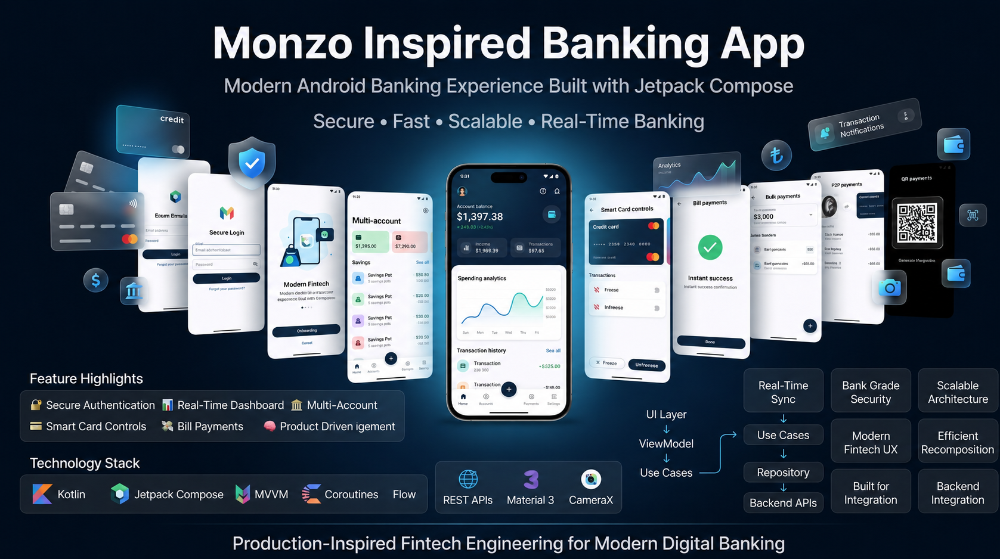
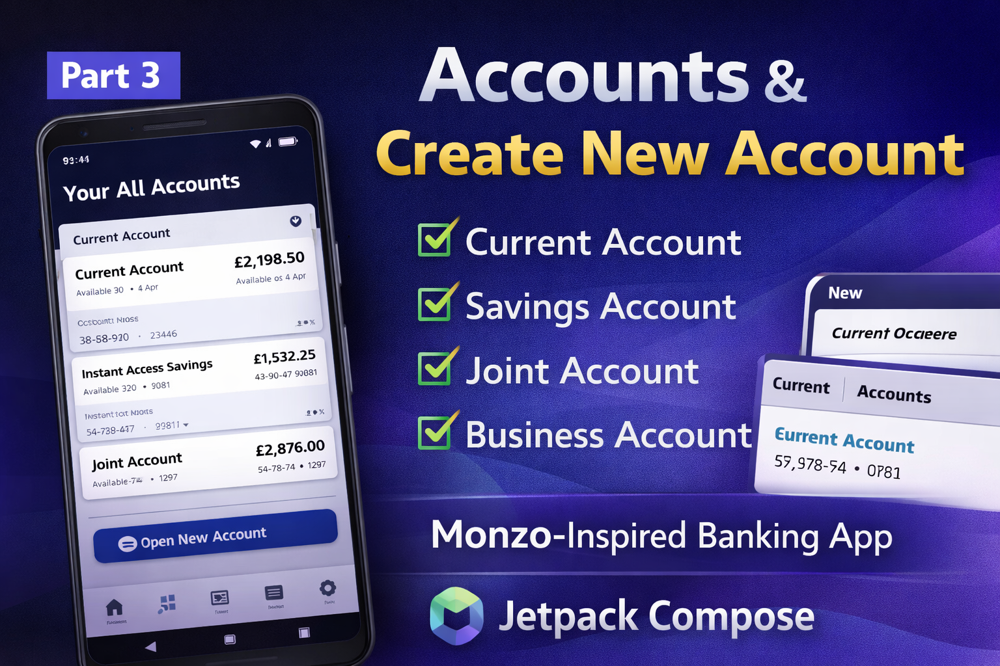
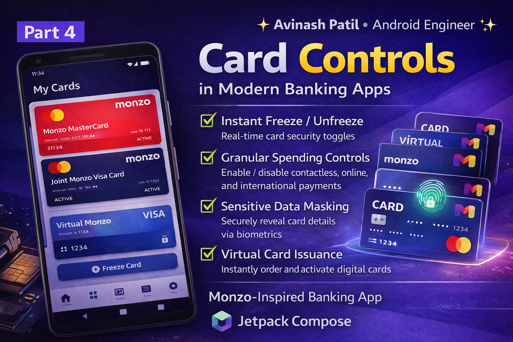

# 💳 MonzoBank — Fintech Banking App (Kotlin + Jetpack Compose)


A **Monzo-inspired fintech banking app**: secure auth, accounts, cards, payments (P2P / Bill / Bulk / QR) — built with **MVVM + Clean Architecture**, documented build-in-public on LinkedIn.

> Portfolio project for **Graduate Android Engineer (Fintech)** roles — e.g. Revolut Graduate Programme 2027: Software Engineer (Android).



## 👀 Quick scan (30 seconds)

| What you want | Proof in this repo |
|---|---|
| Kotlin + Jetpack Compose, Material 3 | 60+ Compose screens in `presentation/ui/` |
| Coroutines & Flow, MVVM | 8 ViewModels with `StateFlow` + `viewModelScope` |
| Dagger Hilt + Retrofit + Room | `di/NetworkModule.kt`, `di/DatabaseModule.kt`, 10 Retrofit APIs, Room cache |
| Fintech domain | Auth, cards (freeze/block/PIN), P2P / bill / bulk / QR payments |
| Testing mindset (TDD) | 97 JVM unit tests across 7 suites in `app/src/test/` (validation, security, error mapping, Room converters, loading state) |
| Ships & communicates | 8-part LinkedIn demo series + screenshots below |

Scale: **~500 Kotlin files · 60+ screens · 10 API services · 70+ repositories · 97 unit tests.**

## 📱 Screenshots

<table>
  <tr>
    <td align="center"><br/>Secure Login</td>
    <td align="center"><br/>Dashboard</td>
    <td align="center"><br/>Accounts</td>
    <td align="center"><br/>Card Controls</td>
  </tr>
  <tr>
    <td align="center"><br/>Bill Payments</td>
    <td align="center"><br/>Bulk Payments</td>
    <td align="center"><br/>P2P Transfer</td>
    <td align="center"><br/>QR Payments</td>
  </tr>
</table>

## ✨ Features

- **🔐 Auth:** login/register, validation, JWT via `TokenManager`, auth/error network interceptors
- **📊 Dashboard:** balance, transactions, API + Room sync
- **🏦 Accounts:** multi-account, create, offline cache
- **💳 Cards:** list, freeze/block, PIN, limits
- **💸 Payments:** bills, P2P, requests — validated success/error states
- **📦 Bulk:** batch payments, per-item status
- **📷 QR:** CameraX scan → instant pay

## ⚙️ Stack fit (Revolut Android → this project)

| Revolut asks | Here |
|---|---|
| Kotlin, Android SDK, Compose | ✅ 100% Kotlin, Compose + Material 3, Navigation, CameraX |
| Coroutines, Dagger, Retrofit, MVVM | ✅ `suspend` APIs, Hilt modules, Retrofit+OkHttp+Moshi, ViewModel+Repository |
| TDD | ✅ 97 JUnit4 tests over form validation, security helpers, error mapping, Room converters and loading state — `./gradlew :app:testDebugUnitTest` |
| RxJava | 🛠️ Roadmap (legacy-stream interop) |

+ Room offline cache, LazyColumn + hoisted `UiState` for smooth recomposition.

## 🏗️ Review in 5 minutes

```
Compose UI → ViewModel (StateFlow) → UseCase → Repository → Retrofit / Room
```

Start here:
1. `di/NetworkModule.kt` — Retrofit + OkHttp + Moshi wiring
2. `data/remote/api/AuthApiService.kt` — `suspend` API style
3. `presentation/viewmodel/AuthViewModel.kt` — StateFlow + validation
4. `utils/InputValidation.kt` + `app/src/test/` — tested fintech validators
5. `data/local/MonzoBankDatabase.kt` — Room cache

## 🎥 Build in public (LinkedIn)

[Part 1 — Login](https://www.linkedin.com/feed/update/urn:li:activity:7441542299500847104/?originTrackingId=gtuPAKLjQqKIqumK3DTlow%3D%3D) ·
[Part 2 — Dashboard](https://www.linkedin.com/feed/update/urn:li:activity:7443314840829501440/?originTrackingId=J5ZfMi97Q6uE5kbn9SMANg%3D%3D) ·
[Part 3 — Accounts](https://www.linkedin.com/feed/update/urn:li:activity:7444387956733149185/?originTrackingId=2lhvKzetTPik22xpi5DNeA%3D%3D) ·
[Part 4 — Cards](https://www.linkedin.com/feed/update/urn:li:activity:7448778143902986240/?originTrackingId=SBKF5YB6TbWD8nXwlyFpsw%3D%3D) ·
[Part 5 — Bills](https://www.linkedin.com/feed/update/urn:li:activity:7449335579231834112/?originTrackingId=MGC6rDlgQZqZWnED9JK31A%3D%3D) ·
[Part 6 — Bulk](https://www.linkedin.com/feed/update/urn:li:activity:7449691663737876480/?originTrackingId=ZrRL4qCESK2BAV1fbPp5Ag%3D%3D) ·
[Part 7 — P2P](https://www.linkedin.com/feed/update/urn:li:activity:7450064159980834816/?originTrackingId=89J%2BMmv%2FQVWgzBkQIhuKAA%3D%3D) ·
[Part 8 — QR](https://www.linkedin.com/feed/update/urn:li:activity:7450422838294986752/?originTrackingId=YJN9Gt5OS9q8fXKhzSFGhg%3D%3D)

## 🧪 Tests

97 JVM unit tests cover everything that is pure logic, so they run in seconds without an emulator:

| Suite | What it pins down |
|---|---|
| `InputValidationTest` (21) | Amount, transfer-limit, password, PIN, name and form-state validators |
| `SecurityUtilsTest` (14) | PIN/amount/transfer checks, fraud heuristic, references, sanitisation, rate limiting |
| `FormFieldValidationTest` (20) | Account number, sort code, card (Luhn), reference, address, postcode and date-of-birth rules |
| `ErrorHandlingTest` (19) | `Throwable.toAppError()` mapping, `Result` states, `safeApiCall` / `safeDatabaseCall`, transaction pre-checks, per-user rate limiting |
| `SecurityHelpersTest` (11) | Bank-detail format checks, PIN generation, card/account/email masking, session timeout |
| `ConvertersTest` (7) | Room type converters (dates, `BigDecimal`, enums, JSON maps/lists) |
| `LoadingMessagesTest` (5) | Loading copy, icons and `LoadingState` defaults |

```bash
./gradlew :app:testDebugUnitTest
```

Parts that need the Android runtime (`android.util.Patterns`, `android.util.Base64`, Compose UI) are
left to instrumented tests.

## 📦 Run

```bash
git clone https://github.com/Avi6855/MonzoBank.git
```

Requires JDK 17 (the Gradle wrapper is 8.13) and an Android SDK with **compileSdk 35**.

1. Open in Android Studio, let Gradle sync
2. Set `BASE_URL` in `di/NetworkModule.kt`
3. Run the unit tests: `./gradlew :app:testDebugUnitTest`
4. Run ▶️ on device/emulator

Roadmap: ViewModel tests (Turbine + MockK) · RxJava sample · transfers/notifications/offline+.

## 👨‍💻 Author

**Avinash Patil** — Android Engineer | Kotlin | Jetpack Compose · CodeChef 5⭐ (Global Rank 509)

🔗 [LinkedIn](https://www.linkedin.com/in/avinash-patil-278011228/) · 💻 [GitHub](https://github.com/Avi6855?tab=repositories) · 📧 avinashpatil6855@gmail.com

Open for Graduate Android (Fintech) roles 🚀 — willing to relocate: Poland / Portugal / Spain / UAE / UK (hybrid, 3 days in office).

⭐ Star · 🍴 Fork · 💬 Feedback welcome
